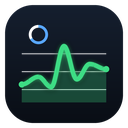

# Android Monitor

A fast, native desktop dashboard that shows **live telemetry from a connected Android device**, polled over
`adb` once per second. Built in Rust with [GPUI](https://gpui.rs). It also ships a built-in
**[MCP](https://modelcontextprotocol.io) server** (stdio and TCP) so AI agents and scripts can read snapshots,
history and raw device data, and manage apps on the device.



## Features

- **Live dashboard** (1 Hz): CPU total + per core, memory breakdown, network Rx/Tx throughput, battery,
  storage, load average, uptime.
- **Donut charts** (memory allocation, storage) and **smooth-scrolling line charts** (CPU, network, memory trend,
  per-core CPU with one colour per core) with auto-scaled axes.
- **Light / Dark theme** toggle in the top-right corner.
- **Device selector** - pick between several attached devices; shows a friendly waiting screen when no device
  is attached or USB debugging is not authorised, and recovers automatically on reconnect.
- **Right-click any chart card to save it as a PNG** (Save As dialog). Charts are rendered off-screen, so the
  image is crisp and independent of your window size.
- **MCP server** over stdio or TCP: snapshots, 1 Hz history, raw `/proc` text, plus app management tools.
- Never blocks the UI: polling runs on a background thread with batched `adb shell` calls (one call per tick).

## Requirements

- `adb` (Android platform-tools) on your `PATH`.
- An Android device with **USB debugging** enabled: *Settings → About phone → tap Build number 7× →
  Developer options → USB debugging*. Connect it and accept the RSA prompt.
- Verify with `adb devices` - the device must show as `device` (not `unauthorized`).

## Install

Download the installer for your platform from the
[Releases](../../releases) page:

| Platform | File |
| --- | --- |
| Windows (x64) | `android-monitor-<ver>-windows-x64-setup.exe` (or the portable `.zip`) |
| macOS (Apple Silicon) | `android-monitor-<ver>-macos-arm64.dmg` |
| Linux (x64) | `android-monitor_<ver>_amd64.deb` or `android-monitor-<ver>-linux-x64.tar.gz` |

macOS builds are not notarised: on first launch right-click the app → **Open**.

### Build from source

```bash
cargo run --release
```

Linux needs development headers first (Debian/Ubuntu):

```bash
sudo apt install build-essential pkg-config libxkbcommon-x11-dev libxkbcommon-dev libwayland-dev \
  libvulkan-dev libfontconfig-dev libfreetype-dev libxcb1-dev libx11-xcb-dev libasound2-dev libssl-dev
```

macOS needs Xcode (for the Metal toolchain); Windows needs the MSVC build tools + Windows SDK.

## Using the app

Run `android-monitor`. Click the device pill in the header to switch devices. Click the sun/moon icon (top
right) to toggle the theme. Right-click a chart card to save it as a PNG.

### Command line

```
android-monitor [OPTIONS]

  --mcp-stdio          Run headless as an MCP server on stdin/stdout.   (add --gui to also open the window)
  --mcp-tcp [ADDR]     Serve MCP over TCP, default 127.0.0.1:8765. Works with the GUI or with --headless.
  --mcp-readonly       Refuse MCP tools that change the device (install, uninstall, launch, stop, permissions).
  --headless           Do not open the window (implied by --mcp-stdio).
  --gui                Open the window even with --mcp-stdio.
```

## MCP server

Transport: **newline-delimited JSON-RPC 2.0** (one JSON message per line), either on stdin/stdout or over a TCP
connection. Protocol versions `2025-06-18`, `2025-03-26` and `2024-11-05` are accepted.

**Security:** the TCP server has no authentication and defaults to loopback (`127.0.0.1`). Do not expose it to
untrusted networks. Use `--mcp-readonly` if a client should only be able to read telemetry.

### Client configuration

stdio (client spawns the process):

```json
{
  "mcpServers": {
    "android-monitor": {
      "command": "android-monitor",
      "args": ["--mcp-stdio"]
    }
  }
}
```

TCP (attach to a running app: `android-monitor --mcp-tcp`), e.g. with `nc`/`ncat`:

```bash
printf '%s\n' '{"jsonrpc":"2.0","id":1,"method":"initialize","params":{"protocolVersion":"2025-06-18","capabilities":{},"clientInfo":{"name":"cli","version":"1"}}}' \
               '{"jsonrpc":"2.0","method":"notifications/initialized"}' \
               '{"jsonrpc":"2.0","id":2,"method":"tools/call","params":{"name":"get_snapshot","arguments":{}}}' \
  | ncat 127.0.0.1 8765
```

### Tools

| Tool | Purpose |
| --- | --- |
| `list_devices` | ADB devices seen and the one being polled |
| `select_device` | Choose a device by serial (or `auto`) |
| `get_snapshot` | Current computed stats: CPU (total/per core), memory breakdown, network rates, battery, storage, load, uptime, device info, polling status |
| `get_history` | Rolling 1 Hz series (~90 s). `metric`: `all`/`cpu`/`memory`/`network`/`cores`, `seconds`: last N samples |
| `get_raw` | Unparsed device text (`stat`, `meminfo`, `net_dev`, `loadavg`, `uptime`, `battery`, `df`, `ip`) and cumulative counters |
| `list_apps` | Installed packages (`type`: `user`/`system`/`all`, `filter`) |
| `list_app_permissions` | Requested permissions and granted state for a package |
| `install_app` | Install an APK from a path on the host (`grant_all_permissions`, `allow_downgrade`) |
| `uninstall_app` | Uninstall a package (`keep_data`) |
| `launch_app` | Launch a package's launcher activity, or a given `activity` |
| `stop_app` | Force-stop a package |
| `grant_permissions` / `revoke_permissions` | `pm grant` / `pm revoke` for a list of permissions |

The device-changing tools (`install_app`, `uninstall_app`, `launch_app`, `stop_app`, `grant_permissions`,
`revoke_permissions`) are refused under `--mcp-readonly`. Package, permission and activity names are validated
against a strict allow-list before they reach the device shell.

### Resources

`android-monitor://snapshot`, `android-monitor://history`, `android-monitor://devices`,
`android-monitor://raw/counters`, and `android-monitor://raw/<source>` for each raw source.

History timestamps: sample *i* of *n* happened at `end_unix_ms - (n-1-i) * 1000`.

## Packaging

| Target | How |
| --- | --- |
| Windows installer | `iscc /DAppVersion=x.y.z packaging\windows\installer.iss` (Inno Setup 6) → `dist\` |
| macOS `.app` / `.dmg` | `packaging/macos/build-dmg.sh x.y.z` (run on a Mac) → `dist/` |
| Linux `.deb` / `.tar.gz` | `packaging/linux/build.sh x.y.z` (needs `cargo-deb`) → `dist/` |
| Icons | `python tools/gen_icons.py` regenerates everything in `assets/` (needs Pillow) |

GitHub Actions (`.github/workflows`) builds and checks every push, and publishes all installers to a GitHub
Release when you push a tag like `v0.1.0`.

## Project layout

```
src/main.rs        CLI flags, headless mode, window setup
src/adb.rs         adb wrapper (timeouts) + defensive /proc and dumpsys parsers
src/telemetry.rs   background poller, rolling ring buffers, shared state
src/charts.rs      donut + smooth scrolling line charts (GPUI canvas/paths)
src/export.rs      off-screen PNG rendering (tiny-skia + ab_glyph)
src/mcp.rs         MCP server (stdio + TCP), tools and resources
src/ui.rs          dashboard layout
src/theme.rs       Theme::dark() / Theme::light()
```

## License

MIT - see [LICENSE](LICENSE).
